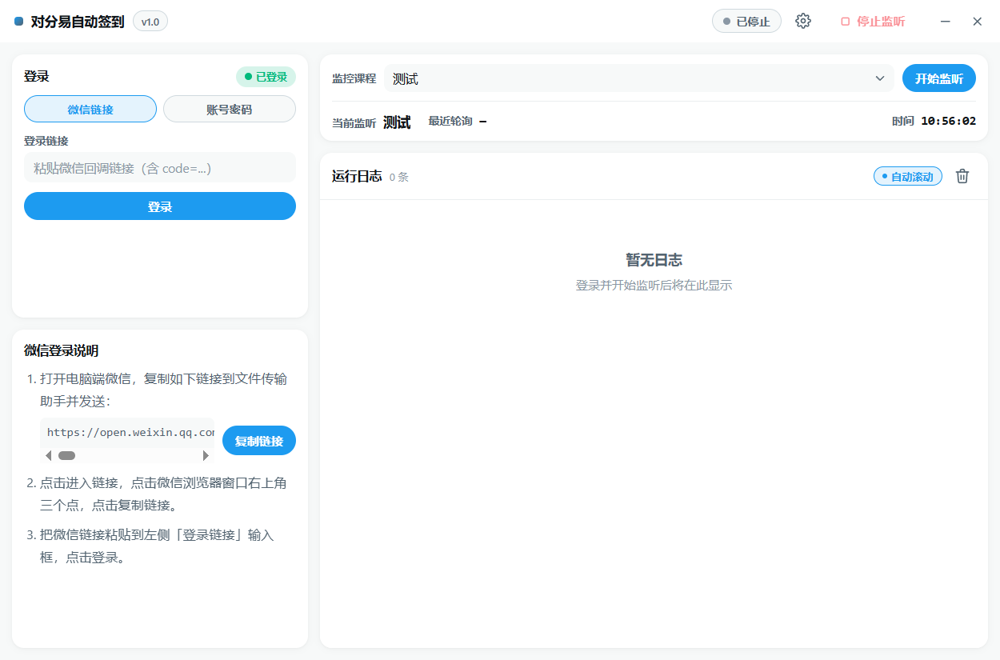

# 🎓 对分易自动签到

> 对分易自动签到工具，持续监听对分易课堂签到活动，自动完成签到码 / 二维码 / 定位 / 汉字四类签到





## 🚀 快速上手


### 运行环境

程序界面基于 WebView2 渲染。Windows 10（1803+）与 Windows 11 通常随系统自带；
若启动时提示缺少 WebView2，运行仓库根目录的 `WebView2Setup.exe` 安装即可。

### 安装与运行

```bash
# 1. 获取源码
git clone https://github.com/bytehola/duifene_auto_sign.git
cd duifene_auto_sign

# 2. 安装依赖
pip install -r requirements.txt

# 3. 启动程序
python main.py
```

### 打包发布（Windows）

```bash
# 在干净的虚拟环境中构建，避免无关依赖混入产物
python -m venv build_env
build_env\Scripts\pip install -r requirements.txt pyinstaller

# onedir 模式，产物在 dist\对分易自动签到\
build_env\Scripts\pyinstaller build.spec --noconfirm
```

---

## 📖 使用指南

### 启动流程

1. 在左栏「登录」面板填写对分易账号和密码。
2. 登录成功后，账号、密码和 App 会话会默认保存。
3. 右栏「监控课程」下拉列表选择课程，点击「开始监听」。

### 登录保活

- 访问 Token 按 App 客户端规则保存 30 分钟，剩余不足 5 分钟时自动刷新。
- Refresh Token 按 7 天保存；刷新响应返回新值时同步更新，未返回时保留旧值。
- 后台每分钟检查一次会话，不依赖是否正在监听课程。
- 临时断网不会删除 Refresh Token，恢复网络后会继续重试。
- 下次启动优先恢复 App 会话；会话不可用时使用保存的账号密码自动登录。
- Windows 下密码使用当前系统用户的 DPAPI 加密，其他平台使用权限为 `0600` 的本地配置文件。

### 支持签到方式

| 签到类型 |
|---------|
| 签到码 (type=1) |
| 二维码 (type=2) |
| 定位签到 (type=3) |
| 汉字签到 (type=4) |

---

## 📄 开源协议

本项目基于 MIT License 发布。
