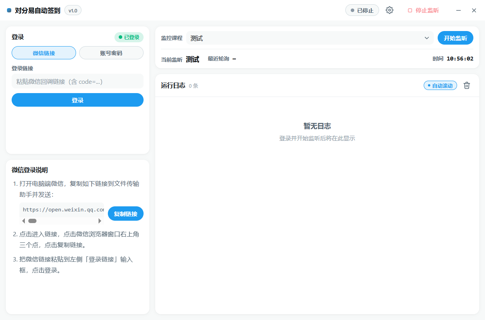

# 🎓 对分易自动签到

> 持续监听对分易课堂签到活动。数字码与静态二维码自动签到已在自有测试课验证；数字码在截止前很短的窗口才出现，成功率受平台返回时机与网络延迟影响。





## 🚀 快速上手


### 运行环境

程序界面基于 WebView2 渲染。Windows 10（1803+）与 Windows 11 通常随系统自带；
若启动时提示缺少 WebView2，运行仓库根目录的 `WebView2Setup.exe` 安装即可。

### 安装与运行

```bash
# 1. 获取源码
git clone https://github.com/bytehola/duifene_auto_sign.git
cd duifene_auto_sign

# 2. 安装依赖
pip install -r requirements.txt

# 3. 启动程序
python main.py
```

### 打包发布（Windows）

```bash
# 在干净的虚拟环境中构建，避免无关依赖混入产物
python -m venv build_env
build_env\Scripts\pip install -r requirements.txt pyinstaller

# onedir 模式，产物在 dist\对分易自动签到\
build_env\Scripts\pyinstaller build.spec --noconfirm
```

---

## 📖 使用指南

### 启动流程

1. 在左栏「登录」面板填写对分易账号和密码。
2. 登录成功后，账号、密码和 App 会话会默认保存。
3. 右栏「监控课程」下拉列表选择课程，点击「开始监听」。

### 学生身份与查询权限

监听使用当前学生账号已加入的教学班，不需要老师账号、教师浏览器或浏览器插件。
程序先读当前学生的个人考勤记录，再按活动 ID 读取详情并校验教学班和有效期。
数字码和二维码类型会按需使用同一学生账号正常登录网页，读取材料并交给 App 提交；
不需要微信授权，网页 Cookie 仅留在内存。当前仅在课程内有一个候选活动、且学生只加入该课程一个教学班时补二维码。

原来的 `GetModelByInProgress` 已退出监听链路。仍被平台拒绝的课程会明确报错并停止监听，
不会切换教师身份，也不会因权限错误清除仍有效的 App 会话。
缺码、过期、作废或身份/班级不匹配的活动不会提交。前导零会保留。

**当前实测：学生 App 详情的签到码为空，学生网页列表在截止前约 1–2 秒才出现带码记录。**
已在自有测试课通过学生独立取码完成数字签到，包含前导零；不需要老师账号或微信扫码登录。
发现活动沿用界面设置的轮询间隔；发现缺码数字活动后，取码请求完成再等待 0.2 秒继续取码。
截止前 5 秒优先取码，暂缓活动发现查询；成功、到期或停止监听后退出快速取码。
0.2 秒是请求之间的等待时间，实际周期还包括网络耗时，不保证每秒完成 5 次请求。
二维码类型已完成两轮学生独立读取与成功提交验证；汉字和定位仍需各自材料可用。
二维码验收见 [学生二维码修复](docs/student-qr-validation.md)。更新源码后请重新安装 `requirements.txt` 中的依赖再重启程序。
数字签到与轮询设计见 [学生数字码验收](docs/student-numeric-validation.md)。
离线测试和受控验证方式见 [测试说明](docs/testing.md)。已有 EXE 不会因源码更新自动更新。

### 登录保活

- 访问 Token 按 App 客户端规则保存 30 分钟，剩余不足 5 分钟时自动刷新。
- Refresh Token 按 7 天保存；刷新响应返回新值时同步更新，未返回时保留旧值。
- 后台每分钟检查一次会话，不依赖是否正在监听课程。
- 临时断网不会删除 Refresh Token，恢复网络后会继续重试。
- 下次启动优先恢复 App 会话；会话不可用时使用保存的账号密码自动登录。
- Windows 下密码使用当前系统用户的 DPAPI 加密，其他平台使用权限为 `0600` 的本地配置文件。

### 支持签到方式

| 签到类型 |
|---------|
| 签到码 (type=1) |
| 二维码 (type=2) |
| 定位签到 (type=3) |
| 汉字签到 (type=4) |

---

## 📄 开源协议

本项目基于 MIT License 发布。
